# 스토리라인 v7 — Looped Transformers & Latent Reasoning

AGI26F HW2 · Team 5 (Juhyeon Park, Youngho Kim) · 2026-11-23 · 발표는 영어
**Session A ≈25분 · Session B ≈25분 · 토론** (발표자 계획. 과제 형식은 세션당 30분 + 토론 20분이라 남는 시간은 질문 여유로 쓴다.)

> 문서는 한국어, 슬라이드 문구는 영어. 수치는 `sources/*.md`에서만. `[ours]` = 우리 해석, **`[확인 필요]`** = 원문 미확인(슬라이드에 넣지 않음).
> 아래 # 번호는 **지금 빌드된 덱의 build 번호**다(`build/out/manifest.json`의 `n`). 괄호 안 숫자는 공개 단계 수.
> **발표의 성격: 설명형 survey.** 청중이 아는 것(층을 쌓는다, 긴 CoT로 생각한다)에서 출발해 루프가 무엇을 해소하려는지 설명하고, 아이디어 → 잠재력 → 구현 → 판정 순으로 지도를 펼친다.

---

## 발표의 큰 틀 (v7)

| Part | 발표자의 질문 | 담당 | 시간 | 연구 질문 |
|---|---|---|---|---|
| 0 | 오늘 얘기할 것: looped transformer, 왜 지금 핫한가 (Astra, ICLR) | A | ~3분 | — |
| 1 | 모델이 깊게 생각하게 하기: 지금의 구현과 루프 | A | ~6분 | Q1 |
| 2 | 아이디어: 트랜스포머에 루프를 넣다 (UT·ACT, Giannou) | A | ~6분 | Q2 |
| 3a | 어떻게 구현하나 ①: Huginn (구조 중심, 결과는 핵심만) | A | ~6분 | Q3 |
| — | **발표자 교체** (Huginn이 남긴 질문을 넘김) | | | |
| 3b | Huginn 위에 무엇이 쌓였나: MoR(동적 halting), Ouro(학습된 종료·규모), RLT(토큰 사이) | B | ~12분 | Q3 |
| 4 | 결론: 가져갈 만한가, 무엇을 잃나, 헤드라인 판정 | B | ~11분 | Q4 |
| D | 토론 한 장: Othello 아레나, 안전성, 일반화·ARC-AGI | 둘 다 | 나머지 | — |

**과제 요구 점검**: Session A의 심층 메커니즘은 UT(공유 블록 + ACT)와 Huginn(prelude·core·coda)이 맡는다. Session B는 "Huginn 위에 무엇이 쌓였나"를 보여 주고, 결과마다 주장 vs 측정을 구분한다. 토론에는 수업 연결 질문(안전성, ARC-AGI)이 있다.

## 연구 질문 원장

이끄는 질문(과제 페이지): **토큰을 더 쓰는 대신 층을 재사용해서, 모델이 더 오래 생각할 수 있을까?**
오늘의 세 질문: 무엇인가? 무엇을 할 수 있나? 가져갈 만한가?

| ID | 질문 (덱 영어) | Part | 답 (요지) |
|---|---|---|---|
| Q1 | 더 깊이 생각하게 하는 지금의 두 방법(층 쌓기, 긴 CoT)은 어디서 막히나? | 1 | 층은 파라미터를, CoT는 토큰을 쓴다. 토큰당 깊이는 고정이다. loss 지표는 깊이보다 규모에 반응했지만 추론은 깊이를 요구한다. |
| Q2 | 루프는 원리상 무엇을 할 수 있고, 학습으로 찾을 수 있나? | 2 | 원리상 어떤 프로그램이든(Giannou, 증명). 학습으로 찾은 건 작은 과제뿐(Yang, 한 줄 언급). |
| Q3 | 루프 LM을 어떻게 만들고, 규모를 키워도 이득인가? | 3a–3b | Huginn이 recipe, MoR이 토큰별 깊이·메모리, Ouro가 7.7T 사전학습. 파라미터당 이득, 같은 FLOP 이득은 미확인, 학습 깊이 너머는 하락. RLT는 장난감 규모. |
| Q4 | 가져갈 만한가, 무엇을 잃나? | 4 | 학습한 깊이까지는 가져갈 만하다. 루프만으로 모니터링이 나빠지진 않았지만, 압박 속 깊은 루프는 힌트를 숨겼다. Astra 루프는 미확인. |

**최종 답**: *그렇다, 학습한 깊이까지는. 그 너머는 아직 아니고, 루프가 더하는 생각은 읽기가 더 어렵다.*

**콜백 장치**: (i) #2–3 Astra 훅 → #96 OpenAI 확인 → #106–108 판정. (ii) #9–11 "지표는 깊이보다 규모" → #73–75 Saunshi 1B. (iii) #14–16 RNN vs Transformer → #20 "RNN의 반복을 깊이 축으로" → #66 RLT "다시 시간 축으로" → #111–112 병목. (iv) #17–19 Bitter Lesson → #111–112. (v) #28–33 UT·ACT halting → #63–66 "Huginn 위에 쌓인 것" → #67–69 MoR 라우터, #76–78 Ouro gate. (vi) #13·#20 CoT vs 루프 그림 → #42 Thm 5.4.

---

## 슬라이드 순서 (덱 기준, v7)

### Part 0 — 오늘 얘기할 것 (A, ~3분)
| # | 제목 | 내용 / 출처 |
|---|---|---|
| 1 | Thinking Longer Without Writing More | 제목 |
| 2–3 | Sept 2026: a report said GPT-6 Astra loops, and it went viral | Raschka 그림 1 + 보도 인용 → "OpenAI 미확인, 끝에서 다시 본다" (`astra.md`) |
| 4–5 | Research followed: “looped” papers at ICLR jumped to 189 | ICLR 2024·2025·2026 = 3·4·11 → ICLR 2027 = 189(모델 의미 175). 검색 색인 기준, 투고 ≠ 결과 (`iclr-counts.md`) |
| 6 | Guiding question | 이끄는 질문 + 오늘의 세 질문 + "재귀" 각주 |
| 7 | Four questions for today | |

### Part 1 — 모델이 깊게 생각하게 하기 (A, ~6분) — Q1
| # | 제목 | 내용 / 출처 |
|---|---|---|
| 8 | What we want | `[ours]` 목표 설정 |
| 9–11 | Way 1: stack more layers, measured by scaling laws | `kaplan.md` 1.1절, `saunshi.md` |
| 12 | The price: depth caps a Transformer's steps per token | `ut.md` 부록 B |
| 13 | Today's models get around the cap by writing tokens | Way 2 CoT + 병목 |
| 14–16 | RNNs read step by step; Transformers read all at once | `lstm.md`, `vaswani.md`, `battaglia.md` |
| 17–19 | Transformers won because they scale: the Bitter Lesson | `bitter-lesson.md`, `kaplan.md` |
| 20 | A looped model reuses the same layers instead | 루프가 해소하려는 것 |
| 21 | Answer to Q1 | |
| 22–26 | Roadmap | Part 2로 가는 다리 |

### Part 2 — 아이디어 (A, ~6분) — Q2
| # | 제목 | 내용 / 출처 |
|---|---|---|
| 27 | Q2 표지 | |
| 28–33 | Universal Transformers reuse one block again and again | 심층 메커니즘 + ACT |
| 34–37 | UT spent more steps on the facts that answer the question | cut 후보 |
| 38–40 | A fixed Transformer becomes a computer once you loop it | Giannou 2단계 + Remark |
| 41 | Every result here is a proof, not a measurement | + Yang 한 줄 |
| 42 | In theory, m loops can simulate m steps of chain of thought | Saunshi Thm 5.4 |
| 43 | Answer to Q2 | |

### Part 3a — Huginn (A, ~6분) — Q3: 구조는 자세히, 결과는 핵심만
| # | 제목 | 내용 / 출처 |
|---|---|---|
| 44 | Q3 표지 | |
| 45–50 | Huginn: embed once, loop a core r times, decode once | 심층 메커니즘 5단계 + Remark |
| 51 | Only the middle is looped | `[ours]` 상자 |
| 52–54 | Train on random loop counts; backprop only the last 8 | 학습 recipe |
| 55–58 | Accuracy rises with loops, then saturates task by task | **핵심 결과 1**: GSM8K 0.00 → 42.08 |
| 59–61 | Each token converges at its own pace | **핵심 결과 2**: 토큰별 깊이가 다르다 → MoR의 동기 |
| 62 | Huginn leaves three questions for Session B | **발표자 교체** |

v7에서 뺀 Huginn 결과: 실패한 학습 2건, 잠재 사고의 모양(`OPTIONAL`).

### Part 3b — Huginn 위에 무엇이 쌓였나 (B, ~12분) — Q3: 깊은 아키텍처 설명은 피한다
| # | 제목 | 내용 / 출처 |
|---|---|---|
| 63–66 | What later work stacks on Huginn | **Session B 첫 장.** 한 줄씩: Huginn(기반) → + MoR(동적 halting = UT·ACT, 실행 중 토큰만 KV) → + Ouro(학습된 종료 gate, 7.7T 토큰) → + RLT(상태를 토큰 사이로) |
| 67–69 | MoR gives each token its own number of loops | 그림 2단계로 축소: 라우터가 토큰별 깊이 → 실행 중 토큰만 KV + Remark (`mor.md`) |
| 70–72 | MoR's equal-FLOP win comes partly from more tokens | 주장 vs 측정 |
| 73–75 | At 1B scale, looping lifts reasoning more than perplexity | Part 1 회수 (`saunshi.md` 표 3) |
| 76–78 | Ouro trains an exit gate for every loop | 그림 2단계로 축소: 루프마다 종료 gate → 임계값에서 종료 + Remark (`ouro.md`) |
| 79–80 | A 1.4B looped model beats a 4B dense one on math only | |
| 81–82 | Different data, and Ouro's own control favors no looping | 주장 vs 측정 |
| 83–86 | Looping past the trained depth hurts | "몇 번 돌리나"의 답 |
| 87–89 | RLT, Sept 12: “infinite temporal depth,” zero experiments | |
| 90–92 | RLT, October: three-seed toy results, failures included | 2단계로 축소 + Remark |
| 93 | Answer to Q3 | |
| 94–95 | Is it new? | Raschka, Kaplan 2020의 UT 실험 |

### Part 4 — 결론 (B, ~11분) — Q4
| # | 제목 | 내용 / 출처 |
|---|---|---|
| 96 | What OpenAI confirmed — and what it didn't | #2–3 훅 회수 |
| 97 | Q4 표지 | |
| 98 | Plant a hint, then check if the CoT admits using it | `cotmon.md` |
| 99–102 | More loops on the same model hid the hint on logic tasks | 77.94 → 41.79 |
| 103 | But T = 6 and 8 are past Ouro's trained depth | #83–86 회수 |
| 104 | A looped model vs six non-looped ones: no penalty | 81.35% vs 66.08–76.92% |
| 105 | Answer to Q4 | |
| 106–108 | Verdict on the headlines | |
| 109 | Where claims ran ahead of measurements | |
| 110 | Four questions, four answers | |
| 111–112 | Back to the Bitter Lesson: do loops scale? | 병목 5개 |
| 113–114 | Conclusion | 최종 답 → 무엇이 나오면 끝나나 |

### 토론 (한 장) + 마무리
| # | 제목 | 내용 |
|---|---|---|
| 115 | Discussion: three questions | ① Othello 아레나 에이전트에 루프를 넣을 수 있을까, 어디에·어떻게? (`[ours]` 출발점) ② 추론이 루프로 들어가면 CoT 대신 무엇을 감시하나? (안전성) ③ parity는 되고 덧셈은 안 되는 외삽, ARC-AGI에 도움이 될까? (일반화) |
| 116 | Thank you | 참고문헌 |

## 전체 로드맵 (overview 그림)

화살표는 인용 관계가 아니라 **"앞 단계가 남긴 질문 → 다음 단계의 기술"** 의 흐름이다. 노란 상자 6개가 과제 페이지의 핵심 논문이다. 점선은 대안 경로, 확인되지 않은 보도, 개념적 연결이다. Yang·Saunshi는 그림에서 뺐다. 덱에는 편집 가능한 도형으로 이미 있다(`common.js`의 `roadmap()`, 5단계 공개).

```mermaid
flowchart LR
  subgraph ROOT["뿌리 · ~2017"]
    direction TB
    RNN["RNN<br/>같은 가중치를 시간 축으로 반복<br/>반복 계산에 강함 · 병렬 학습 불가"]
    ACT["ACT · Graves 2016<br/>언제 멈출지 배운다"]
    TF["Transformer · 2017<br/>병렬 학습으로 scale 성공<br/>그러나 깊이 고정"]
  end
  subgraph ORIGIN["2018 · 기원"]
    UT["① Universal Transformers<br/>Dehghani et al. 2018"]
  end
  subgraph THEORY["2022–23 · 이론과 대안"]
    direction TB
    COT["Chain-of-Thought<br/>토큰을 써서 생각한다 · 모델 밖"]
    GI["② Looped Transformers as<br/>Programmable Computers<br/>Giannou et al. 2023"]
  end
  subgraph SCALE["2025 · 돌파와 확장"]
    direction TB
    HU["③ Huginn<br/>Geiping et al. 2025"]
    MOR["④ Mixture-of-Recursions<br/>Bae et al. 2025"]
    OU["⑤ Ouro<br/>Zhu et al. 2025"]
  end
  subgraph FRONT["2026 · 최전선과 헤드라인"]
    direction TB
    RLT["⑥ Recurrent Looped Transformer<br/>Princeton 2026.09"]
    AS["GPT-6 Astra 보도<br/>2026.09 · OpenAI 미확인"]
    OPEN["열린 질문<br/>같은 FLOP 비교 · 학습 깊이 너머 · 루프 읽기"]
  end

  TF -->|"Q. 깊이가 고정이면 순차 계산 단계가 막힌다"| UT
  RNN -->|"같은 블록 반복을 깊이 축으로"| UT
  ACT -->|"토큰별 halting"| UT
  TF -.->|"우회책: 생각을 토큰으로 쓴다"| COT
  UT -->|"Q. 반복하면 원리상 무엇까지 계산하나?<br/>→ 구성적 증명"| GI
  GI -->|"Q. 실제로 학습시켜 LM 규모로 쓸 수 있나?<br/>→ prelude·core·coda, 입력 재주입, 무작위 반복 수"| HU
  COT -.->|"대안: hidden state를 반복해 생각 · 모델 안"| HU
  HU -->|"Q. 모든 토큰에 같은 깊이가 필요한가?<br/>→ 라우터가 토큰별 깊이 배정"| MOR
  HU -->|"Q. 사전학습 규모에서도 통하나?<br/>→ 7.7T 토큰 + 학습된 exit gate"| OU
  OU -->|"Q. 깊이를 토큰 사이로 이어 갈 수 있나?<br/>→ 이전 토큰의 상태를 넘긴다"| RLT
  RNN -.->|"시간 축 재귀로 돌아옴"| RLT
  OU -.->|"보도: frontier 모델도 루프를 쓴다?"| AS
  AS -.->|"Q. 추론이 안 보이면 감시는?"| OPEN
  MOR --> OPEN
  RLT --> OPEN

  classDef core fill:#fde68a,stroke:#b45309,stroke-width:2px,color:#1f2937
  classDef rumor stroke-dasharray:5 5
  class UT,GI,HU,MOR,OU,RLT core
  class AS rumor
```

---

## 논문 배정 (v7)

과제 페이지 참고문헌 8개는 모두 들어 있다: UT(#28–37), Giannou(#38–41), Yang(#41 한 줄), Huginn(#45–62), MoR(#64, #67–72), Ouro(#65, #76–86), RLT(#66, #87–92), Raschka(#2–3, #94–95). 우리가 추가한 것: ICLR 투고 수(#4–5), Kaplan·Sutton·LSTM·Vaswani·Battaglia(Part 1), Saunshi(#9–11, #13, #20, #42, #73–75), Astra 시스템 카드(#96), cotmon(#98–104).

## 시간과 cut list

- 목표(대본 기준): Session A 22분(s1 9.25, s2 6.5, s3 6.25), Session B 23.5분(s4 12, s5 7.25, s6 4.25). 확인은 `build/out/timing.md`.
- 넘칠 때 뺄 순서: #34–37 UT 단계 수 → #70–72 MoR 같은 FLOP 표(카드 #109에 같은 사실이 있음) → #94–95 새로움.
- 다시 켤 수 있는 장(`OPTIONAL`): Yang 3장, Giannou 그림 5, Saunshi 같은 FLOP 비교, Huginn 실패 run·잠재 사고의 모양, MoR 처리량, Ouro 지식 저장, Astra 타임라인, cotmon T=4/T=8.

## 아직 확인할 것

1. ICLR 숫자는 OpenReview 검색 색인 기준이다. 전체 목록 대조는 OpenReview의 bot 확인에 막혀서 못 했다(`sources/iclr-counts.md`).
2. 토론 ①의 출발점 문구는 발표자가 다듬을 것.

---

## v2 반영 (2026-11-04) — 승인됨, 결론·토론은 Claude 초안 (발표자 검토 전)

- 구조(Q1–Q4, A/B 경계) 승인. #43 `[ours]` 표기 승인.
- #50 핸드오프를 "Session B로 넘기는 질문 3개"로 바꿈: ① 계산 가치 → Q3 ② 토큰별 깊이 → Q3 ③ 읽을 수 있나 → Q4.
- 결론(#83, 2 builds): *Yes — up to the depth it was trained for. Beyond that, not yet; and what it adds is harder to read.* + "What would settle it": (1) same-data, same-FLOP dense 비교 at scale (2) 학습 깊이 너머에서도 오르는 학습법 (3) 토큰이 아니라 loop 자체를 읽는 방법.
- 토론 3개, 각 슬라이드에 "Our starting point" 회색 상자:
  1. novelty — 아이디어는 2018년 그대로, 새것은 recipe(injection, random depth, truncated backprop, norm)와 scale(800B–7.7T).
  2. safety — loop 수/토큰별 깊이, latent 경로 probe, 학습 범위 안의 loop 수 유지. 검증된 것 없음.
  3. generalization·ARC-AGI — loop는 한 단계를 반복할 뿐, ARC는 새 조합을 요구. 반복이 그걸 준다는 증거 없음.
- 산출물: `build/out/looped-transformers.pptx` (149 builds ≈ 87 아이디어). 빌드: `node build/build.js`, QA: `build/qa.sh build/out/looped-transformers.pptx`.

## v3 변경 기록 (2026-11-21) — 발표자 7단계 틀 반영

- 큰 틀을 연구 질문 순서(§1–§7)에서 발표자의 7단계(뭔데 → 왜 핫한가 → 아이디어 → Astra → 함의 → 할 일 → AGI)로 바꿈. Q1–Q4 원장은 유지하고 Part에 매핑.
- **순서 변경**: Astra(v2 #71–72)와 RLT(v2 #78–79)를 §5 Q4에서 Part 4로 옮김. Q4는 CoT 모니터링만 남겨 Part 5 "함의"가 됨. "주장 vs 측정" 카드(v2 #82)를 Part 5로 옮김.
- **신규 7장**: #6 헤드라인 훅, #7 이전의 문제 두 겹, #56 Q3 표지, #75 새로움 판정(Raschka), #78 헤드라인 판정, #87 ICLR 동향(선택, 숫자 미확인), #89 "무엇이 나오면 끝나나" + 독자용 체크 질문.
- 토론 순서를 안전성 → 일반화·ARC-AGI → 새로움(선택)으로 변경.

## v4 변경 기록 (2026-11-21) — 한국어화, 논문 배정, 로드맵, survey 성격

- 문서 전체를 한국어로 바꿈(연구 질문, 슬라이드 제목 포함). 슬라이드에 들어갈 영어 문구는 빌드 때 옮긴다.
- 맨 앞에 **전체 로드맵**(Mermaid)을 추가. RNN·ACT·Transformer에서 출발해 핵심 6편(UT, Giannou, Huginn, MoR, Ouro, RLT)이 어떤 질문으로 이어지는지 보여 준다. Yang·Saunshi는 그림에서 뺐다. v2 #6 타임라인 슬라이드(#8)를 이 그림으로 바꾸고, 각 Part 표지에서 다시 띄운다.
- **논문 배정 총표**와 Part별 "배정 논문"·"추가 후보"를 추가. 과제 페이지 참고문헌 8개가 모두 본문에 있음을 표에 명시. 후보는 `hw2-guide-ko.html` 읽기 목록(38편)에서 가져왔고 설명은 그 목록의 초록 기준 요약이다. 후보의 수치는 저자 보고값이므로 슬라이드에 쓰기 전에 원문을 확인한다.
- 발표 성격을 "survey"로 명시.
- "핵심 6편"은 과제 페이지의 A·B 제안 목록에서 Astra 블로그를 뺀 6편으로 해석했다(발표자 확인 필요).
- (같은 날 추가) Part 1을 **RNN vs Transformer 비교**(장점·단점·inductive bias, #2)와 **Bitter Lesson**(#3)으로 시작하도록 바꿈. 이 흐름이 "Transformer가 잃은 것(#4) → 되찾는 두 방법(#5–6) → UT"로 이어진다. 결론부에 **#91 "Bitter Lesson 다시: 루프는 scale하나? 병목은?"**을 추가하고 병목 다섯 개를 `[ours]`로 정리. 이 때문에 v4 #2 이후 번호가 2칸(#89 이후는 3칸) 밀렸다. 위의 v2·v3 기록 속 번호는 당시 번호 그대로 둔다.

## 덱 반영 기록 (2026-11-21) — `build/*.js`를 v4 순서로 수정

- 덱은 위 표와 거의 같지만 다음이 다르다. 슬라이드 번호는 이 문서의 #번호와 어긋날 수 있다.
  - **빠진 장 (시간 예산, cut list 순서)**: #11 빈칸 표(로드맵 캡션으로 흡수), #52 잠재 사고의 모양(Huginn 그림 12), #66 MoR 처리량, #75 Ouro 지식 저장 장난감 실험, #89 ICLR(숫자 미확인이라 만들지 않음). 코드는 `OPTIONAL = false` 스위치로 꺼 두었고(`s3_q2.js`, `s4_q3.js`), 대본은 해당 `.md` 안에 주석으로 남겼다.
  - **로드맵**: 이미지가 아니라 편집 가능한 도형(`common.js`의 `roadmap()`). 각 질문 표지에는 핵심 6편 칩 줄(`strip()`)로 현재 위치를 표시한다.
  - **Session B 시작**: #55 "If GPT-6 Astra loops, what do we actually know?" → Astra 타임라인 → OpenAI 확인 → Q3 표지(#58 역할) 순.
- 이전 덱과 대본 백업: 스크래치패드 `build-v2-backup/` (세션이 끝나면 지워질 수 있음).

## v5 변경 기록 (2026-11-21) — 발표자 개요 반영, 발표자 검토 전

- 큰 틀을 발표자 개요로 교체: 오늘 얘기할 것(Astra 훅) → 깊게 생각하게 하기(층 쌓기·긴 CoT·RNN vs Transformer) → 아이디어(UT·ACT, Giannou, Yang) → 구현(Huginn, MoR, Ouro, RLT) → 결론 → 함의 → 토론(Othello).
- 세션을 각 20분으로 잡고 세션 경계를 "아이디어까지 / 구현부터"로 옮김. Huginn이 Session B로 가서, Session A의 심층 메커니즘은 UT(+ACT)가 맡는다.
- 연구 질문 Q1–Q4를 새 흐름에 맞게 다시 씀(Q1 기존 방법의 병목, Q2 루프의 잠재력과 학습 가능성, Q3 구현과 확장, Q4 가져갈 만한가).
- 발표자 개요에 없던 Yang(과제 참고문헌, Giannou의 열린 질문에 대한 첫 답)과 Ouro(과제 핵심 논문, "scale-up 해도 관찰되나"·"몇 번 돌리나"에 답)를 넣음. RLT는 "디코더 일반화" 역할로 한정.
- Part 1의 병목 근거로 Kaplan 1.1절("성능은 규모에 강하게, 모양(깊이 대 너비)에는 약하게 의존")을 원문 확인 후 `sources/kaplan.md`에 추가.
- v4 원본: 스크래치패드 `storyline-v4-backup.md`.

## v6 변경 기록 (2026-11-21) — 발표자 피드백 반영

- "Qwen·DeepSeek는 긴 CoT에 기댄다" 삭제.
- 세션을 각 25분으로. Huginn을 Session A 끝에 두고, 발표자 교체는 Huginn 핸드오프 뒤에서 한다. Q3는 Session A(Huginn)에서 시작해 Session B에서 끝난다.
- Yang은 #39에 한 줄로 축소(슬라이드 3장 OPTIONAL). Saunshi 같은 FLOP 비교, Giannou 그림 5도 OPTIONAL. Giannou 소절은 2단계 그림 + 증명 표로 압축.
- Astra 훅을 Part 0으로 올리고, OpenAI 확인·판정은 Part 4에서 회수. Astra 타임라인과 cotmon T=4/T=8 예시는 OPTIONAL.
- Part 5는 논의 거리 소개 한 장. 토론 첫 질문은 "Othello 아레나에 루프를 넣을 수 있을까, 어떻게?"로 바로 넣음. 새로움 질문은 본문으로.
- 질문 원장 Q1–Q4 문구 교체(`common.js`). 꺼 둔 장의 대본은 각 `.md` 끝 ARCHIVE 주석에 보존.
- v5 원본: 스크래치패드 `storyline-v5-backup.md`, v4 덱: `build-v4-backup/`.

## v7 변경 기록 (2026-11-21)

- ICLR 투고 수 확인 후 #4–5에 추가(OpenReview 검색: 2024 3, 2025 4, 2026 11, 2027 189). 방법과 한계는 `sources/iclr-counts.md`.
- 토론을 한 장(#115)으로 합침. Part 5 소개 장과 토론 3장은 없앰.
- Huginn 결과는 핵심 둘(반복 수에 따른 성능, 토큰별 수렴)만 남기고 실패 run·잠재 사고의 모양을 뺌.
- Session B 첫 장을 "Huginn 위에 무엇이 쌓였나"(#63–66)로 바꿈. MoR·Ouro·RLT 그림은 2단계로 줄여 깊은 아키텍처 설명을 피함.

